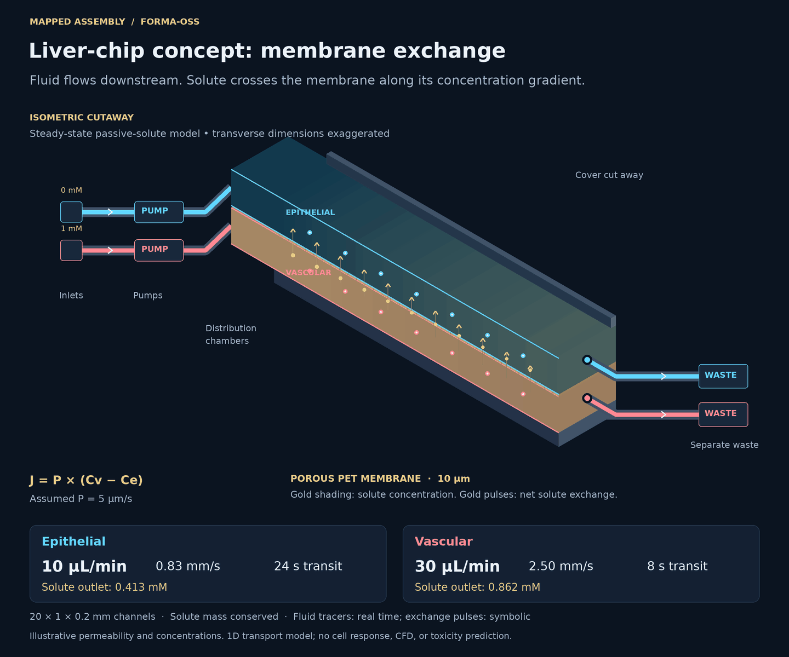

# Reusable fluid systems

`FluidicSystem` describes reusable fluid-network components, connectivity and
operating constraints. Liquid transfer, mixing and microfluidic organ-on-a-chip
designs compose the same primitives and use the same deterministic validator.
Membranes, separate circuits, waste collection and specific channel sizes are
design requirements supplied by the task, not prerequisites for every network.

Issue [#3](https://github.com/Mapped-Assembly/forma-oss/issues/3) introduced the
optional `fluidic_system` boundary in `HardwareIntermediateRepresentation` for
the hackathon milestone. Payloads that omit it still work. The existing IR name,
mechanical/electrical schema and exporters remain unchanged; the broader IR
architecture in #2 is separate future work.

## Use the contract

Models, graph traversal, validation, calculations, examples and scoring live in
`forma_core/fluidics/`. Import the typed models from `forma_core.fluidics.models`.

```python
from pathlib import Path
from forma_core.validation import validate_project
from forma_core.workspaces.projects.models import HardwareIntermediateRepresentation

project = HardwareIntermediateRepresentation.model_validate_json(
    Path("examples/fluidics/liquid-transfer.json").read_text()
)
issues = validate_project(project)  # electrical checks plus optional fluidics
assert not issues
assert HardwareIntermediateRepresentation.model_validate_json(project.model_dump_json()) == project
```

The OpenCode authoring tools expose this schema in their existing project JSON
argument. Their compile, update and validation operations check fluidics. The
web-research architect can return `WebProjectPlan.fluidic_system`; both staged
and legacy packaging retain it and include blocking fluidics diagnostics. CLI
validation, project iteration, saved outcome evaluation, A2A compilation and
canonical-revision consistency checks also include the fluid network. No new
provider call, migration, runtime dependency or environment variable is needed.

## Authoring rules

| Entity | Meaning and requirements |
| --- | --- |
| Inlet / outlet | Boundary source / terminal sink; every declared boundary must participate in a complete directed flow path. Outlets declare `waste`, `product` or `exhaust`. |
| Reservoir | Positive `volume_ul`, contents, and role `supply`, `junction` or `waste`. Junctions use the same steady-state conservation checks as other internal nodes. |
| Pump / valve | Inline graph nodes. Optional channel `pump_id` / `valve_id` must exist and be an endpoint of that channel. Valves represent the nominal open configuration. |
| Channel | `source_id` and `target_id` reference nodes, never other channels. Length, width and height are finite positive mm values. Material and fluid name are required. |
| Chamber | Positive volume, contents, optional temperature; `inlet_ids` and `outlet_ids` list **all incident channel IDs**, exactly once. |
| Membrane | References two channels or chambers in separate circuits; declares material and positive thickness, optionally pore size and porosity. It never creates a bulk-flow graph edge. |
| Fluid properties | Optional explicit viscosity in Pa·s, density in kg/m³, temperature, liquid/gas phase and Newtonian flag. `channel.fluid` matches the property record's `id`. Unknown properties are never substituted. |

All entity IDs, including property records and membranes, are globally unique.
Extra fields and nonfinite numeric values are rejected. Each node's `circuit_id`
identifies a bulk-fluid isolation group (`default` for a single circuit).
Channels crossing groups are invalid. Give separated organ-chip channels
distinct circuits; a dosing inlet joins the intended circuit, upstream of its
mixing chamber, without entering the other circuit.

`FluidicSystem.model_validate` rejects invalid schemas, dimensions and duplicate
IDs. `validate_fluidic_system` returns structured blocking findings for graph and
operating-constraint errors, allowing an invalid draft to remain inspectable.
It also rechecks schema invariants after in-process edits. The normal project
validation adapter maps these findings to `CRITICAL` issues. Parsing alone does
not certify a network or update the IR's stored `is_valid` flag: run validation.

Checks cover unresolved endpoints, source-to-source / sink-to-sink / self edges,
disconnected components (including cycles), missing outlet paths, complete
chamber ports, pump/valve references, membrane references and circuit isolation.
Directed recirculation is allowed only when every node remains reachable from a
source and can reach an outlet. Membranes do not establish these flow paths.

Targets and bounds use µL/min. If supplied, bounds need a target to verify them.
All known incoming and outgoing flows at an internal node must balance, and
pump targets/capacity are checked against adjacent flow sums. Unknown branch
flows are not solved. A zero target is representable in the structural network;
it does not imply active perfusion or a finite residence time. Valve control,
pump head curves, reservoir accumulation and transient operation are out of scope.

The current topology contract covers directed networks with sources and terminal
outlets. A fully closed circulating loop without a source/sink boundary is not
supported by this MVP. General-purpose primitives do not imply support for every
flow configuration or physical regime.

## Physical estimates

The helpers operate on a rectangular channel with an explicitly supplied target
flow. With width `w`, height `h`, length `L` and volumetric flow `Q`:

| Helper | Calculation |
| --- | --- |
| `cross_sectional_area_mm2` | `w * h` |
| `channel_volume_ul` | `w * h * L` (1 mm³ = 1 µL) |
| `average_velocity_mm_s` | `(Q / 60) / (w * h)` for Q in µL/min |
| `residence_time_s` | `volume * 60 / Q`; zero or missing Q raises |
| `reynolds_number` | `rho * velocity * hydraulic_diameter / mu`, in SI units |
| `pressure_drop_kpa` | Approximate `12 mu L Q / [w h³ (1 - 0.63 h/w)]`, with the smaller transverse dimension used as h |
| `mean_wall_shear_stress_pa` | Wetted-perimeter mean `Δp * area / (length * perimeter)`; **not** local cell-surface shear |

Pressure/shear estimates require explicit viscosity and density, a matching
liquid property record, Newtonian flow and Reynolds number below 2000. This
threshold is a scope guard, not proof that entrance or inertial effects are
negligible. Assumptions are steady, fully developed, incompressible laminar flow
in rigid, straight, constant-section channels. No branch pressure solve, minor
losses, PDMS deformation, membrane leakage or biological validation is provided.
The rectangular pressure approximation is less accurate near square sections.
There is no hard-coded microscopic size range. The mm and µL units are explicit
storage conventions; validity of the physical approximation depends on geometry
and flow assumptions, including Reynolds number, rather than the application name.

`max_pressure_kpa` is a **channel differential-pressure budget**, not an absolute
pressure rating or a pump-head limit. If it is supplied, insufficient inputs or
an unsupported regime are blocking `pressure_unknown` findings. Without a
pressure budget, geometric/topological checks can run without fluid properties;
calling a pressure helper still fails clearly if those properties are absent.

Sources for the approximations and limitations:

- [In situ pressure measurement within deformable rectangular PDMS microfluidic devices](https://pmc.ncbi.nlm.nih.gov/articles/PMC3365910/), rectangular resistance approximation and deformation limitations.
- [Towards an Optimal Pressure Tap Design for Fluid-Flow Characterisation at Microscales](https://pmc.ncbi.nlm.nih.gov/articles/PMC6479773/), rectangular-channel force balance relating pressure drop to mean wall shear.

## Examples and benchmark

`examples/fluidics/liquid-transfer.json` represents a 1 L supply tank feeding a
pump and product-collection outlet through two 1 m rectangular channels with
10 × 5 mm sections at 6 mL/min. It has no membrane, tissue region, required waste
outlet or microfluidic-specific validation. Its external specification requests
the product path, flow and geometry. Fluid properties are explicitly labeled as
demonstration inputs. Run the same validator and scorer used by every example:

```sh
python -m forma_core validate examples/fluidics/liquid-transfer.json
python -m forma_core.fluidics.benchmark examples/fluidics/liquid-transfer.json --spec examples/fluidics/liquid-transfer-spec.json
```

`examples/organ-on-chip/` contains full Hardware IR JSON, separate task
specifications, and an intentionally broken network:

- `two-channel.json`: vascular 30 µL/min and epithelial 10 µL/min, separate waste,
  a membrane, pumps, distribution chambers and explicit illustrative properties.
- `with-dosing.json`: additional 5 µL/min inlet and inline valve feeding the
  vascular chamber; the vascular outlet channel carries the summed 35 µL/min.
- `broken-missing-outlet.json`: vascular channel points at an undeclared waste
  endpoint and must fail.



This application-specific GIF is an assembled isometric cutaway rendered from the
checked example JSON. The two continuous inlet → pump → distribution chamber →
main channel → waste circuits contact opposite faces of the porous membrane.
It is not a CAD export or CFD result. Geometry is schematic and thickness is
exaggerated. Main-channel tracers use one common length scale and real-time Q/A
mean velocities: 0.83 mm/s epithelial and 2.50 mm/s vascular. The 20 mm channels
therefore have 24 s and 8 s transit times. The 12 s loop returns to the same
tracer phase without a reset jump. Passive solute exchange is calculated using a mass-conserving steady-state
1D model with explicit illustrative permeability and inlet concentrations.
Gold shading follows calculated concentrations; upward gold pulses indicate
net exchange, with symbolic timing rather than molecular crossing times.
Biological response is not simulated. See [membrane exchange](membrane-exchange-demo.md)
for equations, assumptions, provenance, and conservation checks. The renderer rejects unsupported topology, dimensions and flows
rather than silently drawing a different network.

Run from the repository root after installing Forma's Python dependencies:

```sh
python -m forma_core validate examples/organ-on-chip/two-channel.json
python -m forma_core.fluidics.benchmark examples/organ-on-chip/two-channel.json --spec examples/organ-on-chip/two-channel-spec.json
python -m forma_core.fluidics.benchmark examples/organ-on-chip/with-dosing.json --spec examples/organ-on-chip/with-dosing-spec.json
python -m forma_core.fluidics.benchmark examples/organ-on-chip/broken-missing-outlet.json --spec examples/organ-on-chip/two-channel-spec.json
python -m pytest tests/projects/test_fluidics.py -q
python scripts/media/render_fluidic_demo.py --output docs/assets/organ-on-chip-flow.gif
```

The broken example exits 1. Scoring accepts a raw network dictionary or full IR
dictionary and returns named checks, findings, `passed`, and an equally weighted
score in [0,1]. Every task requirement is optional: `required_paths`,
`expected_flow_rates_ul_min`, `required_membranes`, `expected_channel_count` and
`channel_dimensions`. An empty specification checks the declared network's
consistency only; it does not establish compliance with any application brief.
An omitted requirement imposes no restriction in its named check. Core schema,
topology and supplied operating constraints are always checked, including any
membranes that are actually declared.

Paths use `source_id` and `target_id`, which may identify any declared nodes.
Optionally require an endpoint kind with `outlet_kind` (`product`, `waste` or
`exhaust`). Waste reservoirs also satisfy `outlet_kind="waste"`. For example:

```json
{
  "required_paths": [
    {"source_id": "feed_tank", "target_id": "collection", "outlet_kind": "product"}
  ]
}
```

Legacy `waste_id` inputs remain readable and still require a waste endpoint;
canonical serialization writes `target_id` and `outlet_kind="waste"`. Conflicting
legacy and canonical constraints are rejected. The organ-chip specifications
explicitly request waste paths and membrane-separated pairs. The general transfer
specification explicitly requests product collection and no membrane requirement.
Channel count and dimension requirements are likewise supplied by the task:

```json
{
  "expected_channel_count": 6,
  "channel_dimensions": {
    "vascular_channel": {
      "length_mm": {"minimum": 19, "maximum": 21},
      "width_mm": {"minimum": 0.9, "maximum": 1.1},
      "height_mm": {"minimum": 0.18, "maximum": 0.22}
    }
  }
}
```

Add only the fields needed by the task. All dimension bounds are inclusive, finite, positive mm
values; a range may supply just a minimum or maximum. Empty/inverted ranges and
non-integer counts are rejected. Missing constrained channel IDs fail the check.
Findings identify the offending channel and dimension, including its value and
requested bounds. These are task requirements, not assumed manufacturing or
biological limits; choose them before evaluating candidates.

`expected_channel_count` counts **all entries in `FluidicSystem.channels`**,
including supply/feed segments. The two perfusion channels in `two-channel.json`
use six total segments; `with-dosing.json` uses eight. The checked specifications
require those counts and bound both perfusion channels. Geometry constraints
need not be specified for every segment. Without count/dimension requirements,
the original eight checks and score denominator are unchanged. Supplying either
adds its named check (`channel_count` or `channel_dimensions`); the example specs
use all ten checks. Any failed check prevents `passed=true` and CLI exit 0.
Malformed candidate schemas score zero; incomplete or noncompliant designs can
earn a partial score but never pass. Passing only certifies the supplied checks,
not unrequested dimensions or unknown fluid properties.

For benchmarks 1/2, use the same independent task spec to check requested
constraints and deterministic topology/flow/pressure plausibility. Benchmark 4
can mutate the JSON (remove an outlet/pump, reverse a connection, zero a width,
introduce an unknown node or duplicate ID) and inspect `issues`/`schema_errors`;
re-evaluate a repaired candidate with the unchanged spec. Benchmark 6 requires
serialization and all checks to pass. For benchmark 7, retain raw model output,
Forma output before fluid validation, and validated output separately and feed
each to `score_fluidic_system` with that same spec. Do not replace invalid raw
candidates with repaired ones or infer requirements from candidate data.

The checked fixtures score 1.0; this is deterministic fixture validation, not a
measured model-generation success or repair rate.

The included renderer is deliberately specific to the two-channel fixture and
rejects added branches rather than hiding them. It requires Pillow (already an
optional Forma terminal/backend dependency). It does not change OpenCAD/exporters
or add a fluidics UI. Use the JSON and benchmark report as the machine-readable
deliverables for the hackathon.
